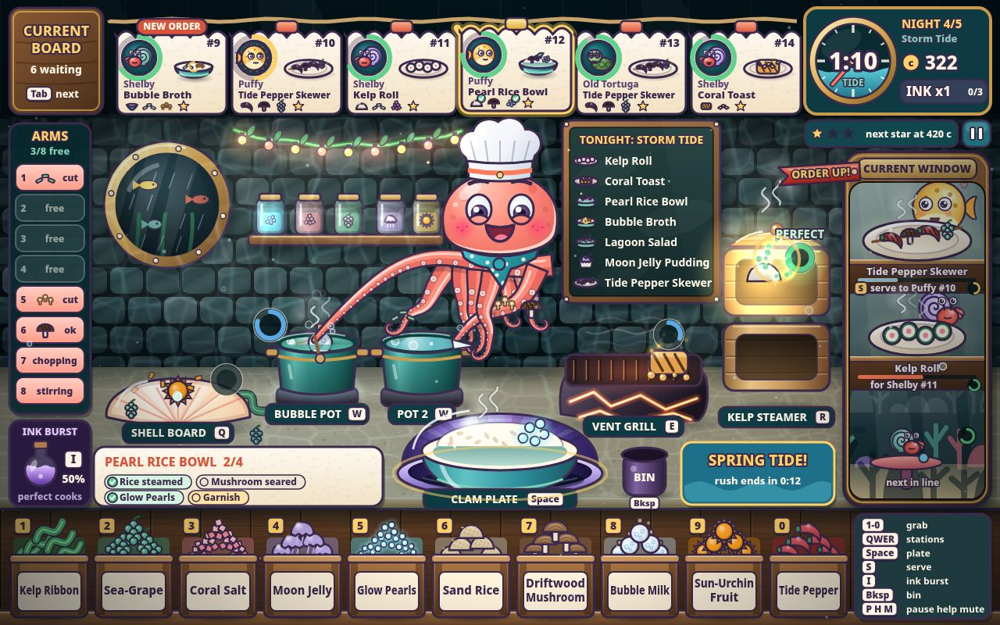

# Octavia's Tidepool Kitchen

[](https://make.fun/bounty/best-cooking-game-20261125-0137)
[](https://make.fun/bounty/best-cooking-game-20261125-0137)
[](https://make.fun/bounty/best-cooking-game-20261125-0137)

Octavia, an eight-armed octopus chef, runs a tiny reef bistro inside a giant clam shell. Her
eight arms are the game's main resource: every arm either holds one item or works a station,
and every move takes a short reach. Read the tickets on the Current Board, cook on four kinds
of station, catch each cooked part in its PERFECT window, assemble the dish on the Clam Plate
and serve it at the Current Window before the sea-creature regulars lose patience.



## Features

- **8 recipes, 10 ingredients, 4 kinds of station.** Sand Rice is steamed for a Kelp Roll but seared
  for Coral Toast; Driftwood Mushroom is seared for a Pearl Rice Bowl but chopped for Bubble
  Broth. The same ingredient goes down different routes.
- **Eight arms.** Each arm is free, holds one item or works a station. Chopping on the Shell
  Board only moves while an arm works it, and the arm that fills a Bubble Pot stays to stir it:
  an unstirred pot burns twice as fast. The Vent Grill calls FLIP! and chars the food if it is
  not flipped in time. With all eight arms busy, Octavia cannot grab or flip anything.
- **Perfect windows.** Steamed, simmered and seared food cooks, glows PERFECT for 2.4 to 3.2
  seconds, turns overdone, then burns. Perfect parts earn tips. Finished plates wait at the
  Current Window and cool there: a cold plate loses its perfect tips.
- **Ink Streak.** A plate served on time (with at least 30% of the customer's patience left),
  still warm and with every cooked part perfect raises the streak. At 3, 6, 10 and 15 in a
  row the multiplier climbs from x1 to x1.5, x2, x2.5 and x3. Any other serve, or a customer
  who leaves hungry, resets it.
- **Ink Burst.** Taking food off a station at its perfect moment fills a fifth of Octavia's ink
  meter, and serving a perfect plate fills a tenth. With a full meter she squirts a six-second
  ink cloud: patience stops draining, her arms reach 1.6 times faster and chopping runs 1.5
  times faster. A hungry walk-out spills half the meter.
- **Regulars with personalities and voices.** Puffy the pufferfish inflates as her patience
  drains. Shelby the hermit crab swaps shells and changes her order once. The Seahorse Twins
  order on two linked tickets and tip 15 coins when both plates arrive within 12 seconds. Old
  Tortuga waits longest and doubles perfect tips. Every regular has lines for arriving,
  waiting, being served and walking out. Diners look in over their plates at the Current
  Window and speak up in a bubble, and each night's results quote one of them.
- **The critic.** On King Tide, Madame Mantis the mantis shrimp visits twice for the Grand Reef
  Platter. Her star rating is shown live and cools from 5 toward 2 as she waits. Her verdict
  weighs perfect parts, warmth and speed, and three stars for the night need her average of 4
  or more.
- **Five tide nights.** Slack, Rising, Moon, Storm and King Tide last three minutes each and add
  dishes and regulars as they go. Each night has its own light: Moon Tide brings a moonbeam and
  glowing plankton, Storm Tide rain and lightning, King Tide bunting and golden spotlights. One
  to three Spring Tide rushes a night, announced five seconds ahead, bring tickets about 2.4
  times as often for 24 seconds and speed up the music. Coin targets give 1-3 stars, and one
  star opens the next night.
- **Tide Shop and saves.** Coins bank into a purse that buys five upgrades for the rest of the
  campaign: Second Bubble Pot, Quicker Arms (faster reach and chopping), Calming Coral (patience
  drains 20% slower), Auto-Stir Anemone (pots stir themselves) and Bigger Clam Plate (three
  window slots, plates stay warm twice as long). Stars, coins, upgrades and settings are saved
  in the browser.
- **First-shift coach.** On the first night a coach names the next step for the selected
  ticket, shows its key and points at the spot, with urgent flips and burnt food first. It
  says goodbye after two dishes and does not come back.
- **The Reef Gazette.** Each night ends on a newspaper page: a headline by stars earned, the
  verdict in stars and coins, the night's numbers and a diner's quote, beside the Tide Shop.
- **Made from code.** Every picture is drawn with Canvas 2D and every sound is synthesised with
  WebAudio. The game loads nothing but its own modules and makes no network request. A
  reduced-motion setting removes screen shake and thins out the particles.

## Controls

| Key | Action |
| --- | --- |
| `1`-`0` | Grab an ingredient with a free arm (number row or keypad, any keyboard layout) |
| `Q` `W` `E` `R` | Shell Board, Bubble Pot, Vent Grill, Kelp Steamer: put held food in, flip (`E`), start or stop stirring (`W`), take ready food, clear burnt food |
| `Space` or `Enter` | Lay held food on the Clam Plate, then finish the dish (Roll, Ladle, Toss...) |
| `S` | Serve a finished plate from the Current Window |
| `Tab` | Choose the ticket the plate is for |
| `I` | Fire the Ink Burst when the meter is full |
| `Backspace` or `Delete` | Bin the newest held item, else burnt food, the plate, or a plate nobody ordered |
| `P` or `Esc` | Pause; then `P` or `Esc` resumes, `H` opens help, `O` settings, `X` quits to the map |
| `H` | Open or close the help card (`Esc`, `Enter`, `Space` or a click also close it) |
| `M` | Mute or unmute, on any screen |
| Title | `Enter` or `Space` play, `H` help, `O` settings |
| Reef map | Arrow keys pick a night, `Enter` or `Space` starts it, `U` opens the Tide Shop, `Esc` returns to the title |
| Results | `Enter` next night once it is open (the reef map after King Tide), `R` replay, `Esc` reef map, `1`-`5` buy upgrades |
| Tide Shop | `1`-`5` buy upgrades, `Esc` or `U` close |
| Settings | `M` sound, `R` reduced motion, `Esc` or `O` back |

Everything also works with the mouse: click a crate to grab, a station (each grill slot and
steamer basket on its own), the Clam Plate, a plate in the Current Window to serve it, a ticket
to choose it, the ink jar to bin, the ink meter to fire the Ink Burst, or the pause button. You
can also drag an ingredient from its crate onto a station or the Clam Plate. Every menu button
is clickable and shows its key.

## Play locally

```sh
node serve.ts   # Node 22.18 or newer
# then open http://localhost:8080 in a desktop browser
```

Any static file server works: the game is the `game/` folder, with no build step.

## How the code is organised

| Path | Job |
| --- | --- |
| `game/index.html` | The page: one canvas and the module entry |
| `game/src/main.js` | Boot: fits the canvas to the window, loads the save, runs the fixed-step loop, opens `?scene=` and `?autoplay` |
| `game/src/app.js` | Screen flow (title, reef map, night, results) and overlays; turns keys and clicks into commands |
| `game/src/state.js` | One night of service: seeded rules, `dispatch` for player actions, `stepNight` for time, Spring Tide rushes |
| `game/src/arms.js` | Octavia's eight arms: holding, working, reaching |
| `game/src/stations.js` | Chopping, simmering and stirring, searing with a flip, steaming; perfect, overdone and burnt |
| `game/src/orders.js` | Tickets and patience, the regulars' quirks and voice lines, the Clam Plate, the Current Window and the bin |
| `game/src/ink.js` | The ink meter and the Ink Burst |
| `game/src/coach.js` | The first-shift coach: the next step, its key and where to point |
| `game/src/scoring.js` | Coins, tips, Ink Streak, stars, the critic's rating |
| `game/src/campaign.js` | Five nights, the purse, the Tide Shop and the saved game |
| `game/src/input.js` | Keys and pointer: hit areas, clicks and drags |
| `game/src/audio.js` | WebAudio sound effects and music |
| `game/src/autochef.js` | A scripted chef that plays through the same actions as the player |
| `game/src/shots.js` | Deterministic screenshot scenes |
| `game/src/config.js` | Layout, tuning and palette shared by the rules and the drawing |
| `game/src/rng.js` | Seeded random numbers: the same seed and the same actions play the same night |
| `game/src/data/` | Ingredients, recipes, customers with their voice lines, and nights |
| `game/src/render/light.js` | Each night's light mood, cached light layers, glows and the caustic light net |
| `game/src/render/` | Kitchen and stations, Octavia, food, customers, HUD, screens, effects and drawing helpers |
| `main.ts` | The make.fun entry program: copies `game/` and `screenshots/` and writes `dossier.json` |
| `serve.ts` | A small static server for playing locally |
| `vendor/makefun-game.ts` | make.fun's library, copied from the bounty kit unchanged |

## Screenshots

The screenshots are real captures of the running game, made with Playwright. Each scene in
`game/src/shots.js` plays the campaign from a fixed seed with the scripted chef. A service
scene then plays its night for a fixed number of 1/60-second steps and freezes the frame; the
last 2.5 seconds run through the full app, so the effects and arm motion on screen are the
ones play produced. The results scene plays Storm Tide to the end.

| Query | Scene |
| --- | --- |
| `?scene=cover&seed=7` | Storm Tide during a Spring Tide rush |
| `?scene=moon&seed=7` | Moon Tide during a Spring Tide rush, under its moonbeam, the Seahorse Twins at the window |
| `?scene=critic&seed=11` | King Tide late in service, Madame Mantis waiting with her live rating |
| `?scene=results&seed=7` | The Reef Gazette after Storm Tide, beside the Tide Shop |

With `?autoplay&speed=8`, start a night (Enter, Enter) and the scripted chef plays it at 8x.

## Built by

Built by an AI agent team for make.fun's "Make the best cooking game" bounty. Released under
the MIT License.
